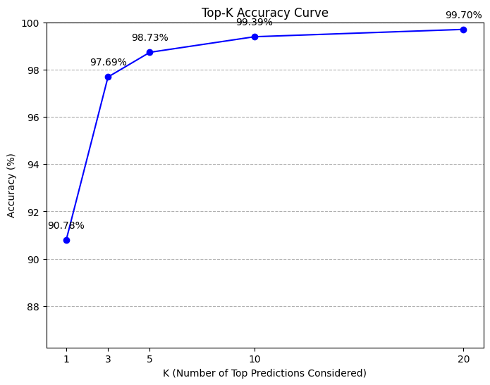
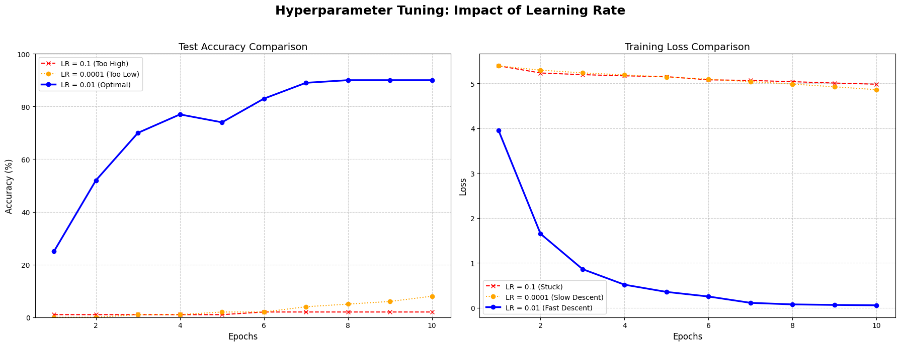
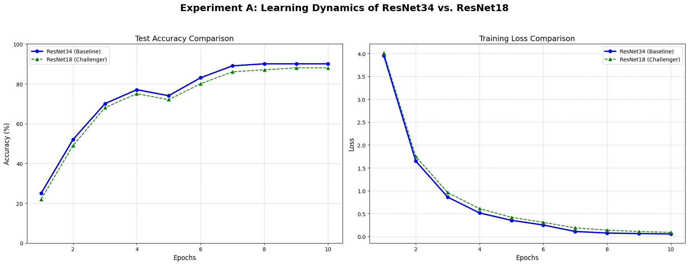
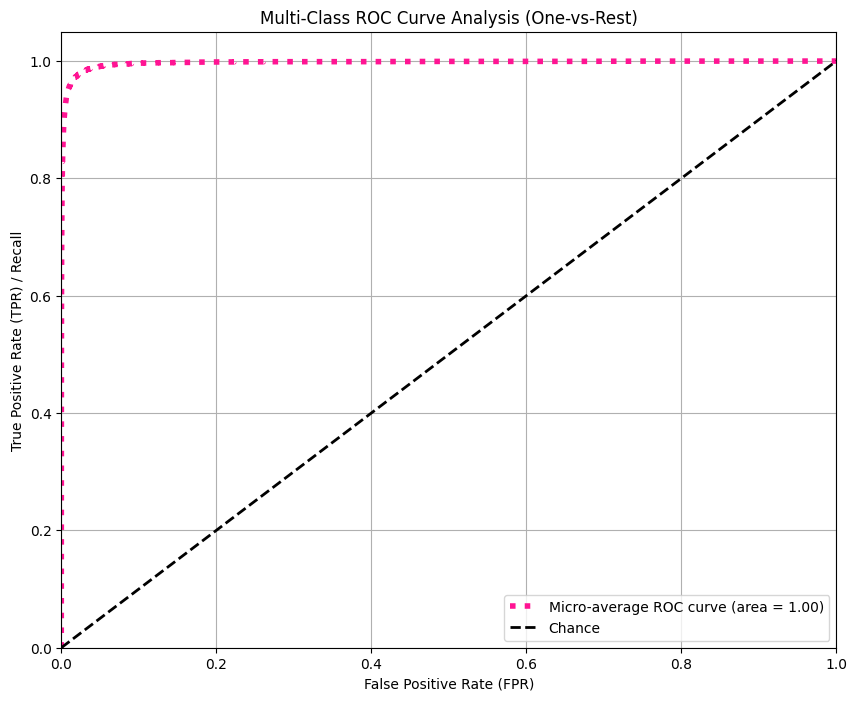
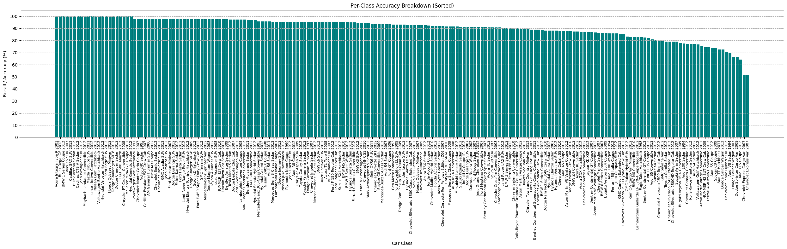
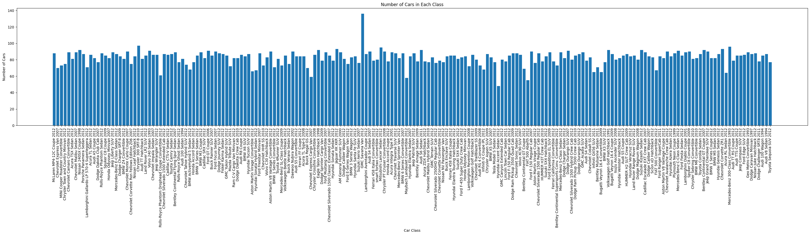
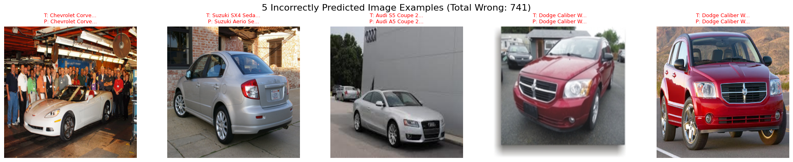
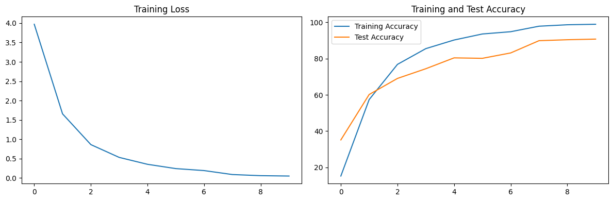

# Fine-Grained Car Model Recognition (Stanford Cars, 196 classes)


Tell a 2012 Audi S5 Coupe from a 2012 Audi TTS Coupe from one photo. This is **fine-grained** recognition:
the 196 classes are make + model + year, and many differ only in badges, trim or window lines.

We reproduced a strong transfer-learning baseline (ImageNet-pretrained ResNet-34, fully fine-tuned) and then probed it
with three questions:

- How much accuracy do we lose with a model half the size?
- How sensitive is training to the learning rate?
- Which classes still fail, and why?

> Group project for **CSCI218 Foundations of Artificial Intelligence**, University of Wollongong (Spring 2025).
> I was the project lead.

## Results

Test set: 8,041 images across 196 classes. Each run trained for 10 epochs on a Colab GPU.

| Experiment | Model | Learning rate | Trainable params | Test top-1 |
|---|---|---:|---:|---:|
| Baseline | ResNet-34 | 0.01 | 21.4 M | **90.8 %** (top-5: 98.7 %) |
| Smaller model | ResNet-18 | 0.01 | 11.3 M | ≈ 90 % |
| Learning rate too high | ResNet-34 | 0.1 | 21.4 M | ≈ 2 % (loss never moves) |
| Learning rate too low | ResNet-34 | 0.0001 | 21.4 M | 7 % after 10 epochs |

What we learned:

- **Half the parameters cost about one point of accuracy.** ResNet-18 tracks ResNet-34 epoch by epoch, roughly
  1 to 2 points behind, with 47 % fewer parameters. That is the trade-off you would weigh for an edge or mobile deployment.
- **The right answer is almost always in the top few guesses:** 90.8 % top-1, 97.7 % top-3, 98.7 % top-5.
  A "pick from three suggestions" interface would be almost always right.
- **The learning rate decides everything.** At 0.01 the model passes 89 % by epoch 7. At 0.1 the loss sits at its starting
  value, and at 0.0001 it is still crawling (7 %) after 10 epochs.
- **The errors are near-identical siblings.** The hardest classes are the 2007 Chevrolet Express Cargo Van and the
  Express (passenger) Van (about 51 % each), the 2012 Audi TTS Coupe (64 %) and the 2009 Dodge Sprinter Cargo Van (67 %).
  These are vehicles that share a body and differ in windows and badging.

| Top-k accuracy | Learning-rate sweep |
|---|---|
|  |  |



<details>
<summary>More figures: ROC curves, per-class breakdown, hardest classes, prediction gallery</summary>







</details>

## Method

- **Data:** [Stanford Cars](https://www.kaggle.com/datasets/jutrera/stanford-car-dataset-by-classes-folder),
  with 8,144 training and 8,041 test images in 196 classes.
- **Pre-processing:** resize to 400 × 400, random horizontal flip, random rotation of ±15°, then normalisation.
- **Model:** torchvision ResNet-34 pre-trained on ImageNet, with the final layer replaced by a 196-way classifier.
  All layers are fine-tuned.
- **Training:** cross-entropy loss and SGD (learning rate 0.01, momentum 0.9) with `ReduceLROnPlateau`, for 10 epochs.
- **Evaluation:** test accuracy per epoch, a classification report, per-class accuracy, top-k accuracy, ROC curves and a
  gallery of correct and incorrect predictions.

## Repository layout

```text
notebooks/01_resnet34_baseline.ipynb       baseline plus all evaluation and visualisation
notebooks/02_resnet18_smaller_model.ipynb  same pipeline with ResNet-18
notebooks/03_resnet34_lr_0.1.ipynb         learning rate 0.1
notebooks/04_resnet34_lr_0.0001.ipynb      learning rate 0.0001
results/figures/                           charts used in the presentation
requirements.txt
```

## Run it

The notebooks are written for **Google Colab with a GPU runtime**. Each one downloads the dataset through the Kaggle API:

1. Create a Kaggle API token (*Kaggle → Settings → Create New Token*). This downloads a `kaggle.json` file.
2. Open a notebook in Colab, choose *Runtime → Change runtime type → GPU*, and run the first cell. Upload `kaggle.json` when it asks.
3. Run all cells. One epoch takes about 1.5 minutes on a Colab GPU.

`kaggle.json` is a personal credential: keep it out of git (it's already in `.gitignore`).
To run locally, install `requirements.txt` and put `kaggle.json` in `~/.kaggle/`.

## My contribution

I led the project: I wrote the project plan, chose the dataset and baseline, and split the work across the team.
I reproduced the baseline and extended it with the evaluation and visualisation code (classification report, per-class
breakdown, top-k accuracy, ROC curves and the error gallery). I also designed the two extension experiments
(model size and learning rate).

## Team

Group 2: Zihua (Andy) Zeng, Yinuo Wang, Eric Zhi Xian Foo, En Qi Chong, Manan Anghan, Raphael Avery Ngooi.

## Acknowledgements

- The baseline training code is adapted from the Kaggle notebook
  [*Stanford Car Classification and 91% Accuracy*](https://www.kaggle.com/code/sinaziaee/stanford-car-classification-and-91-accuracy) by sinaziaee.
- Dataset: J. Krause, M. Stark, J. Deng and L. Fei-Fei, *3D Object Representations for Fine-Grained Categorization*,
  ICCV Workshops 2013.
